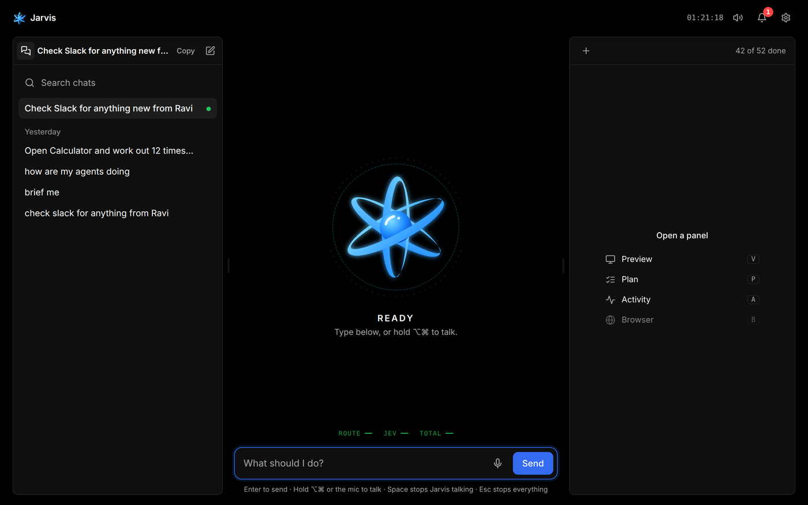
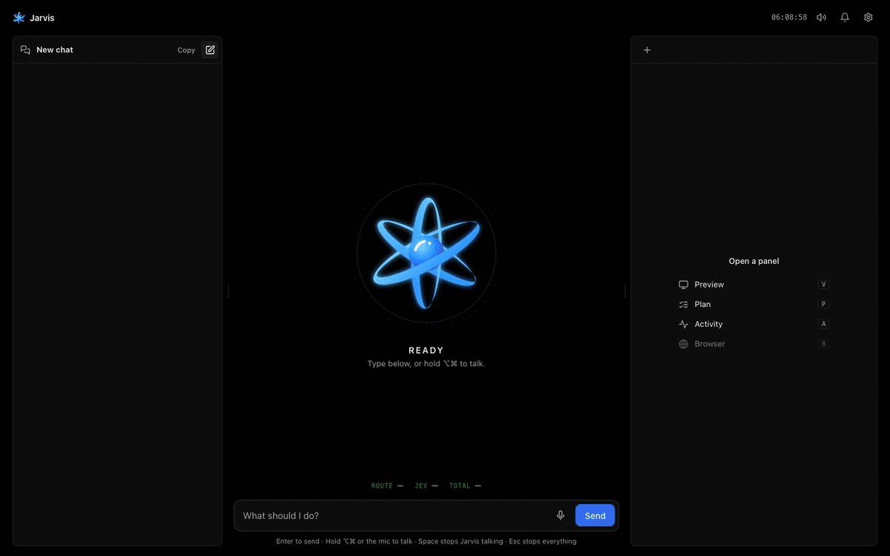
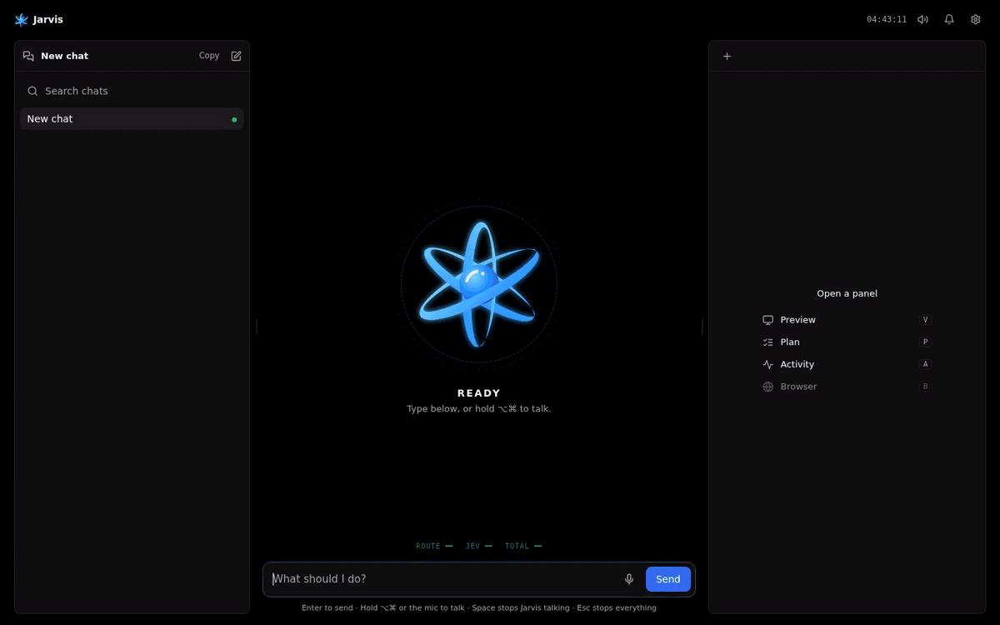
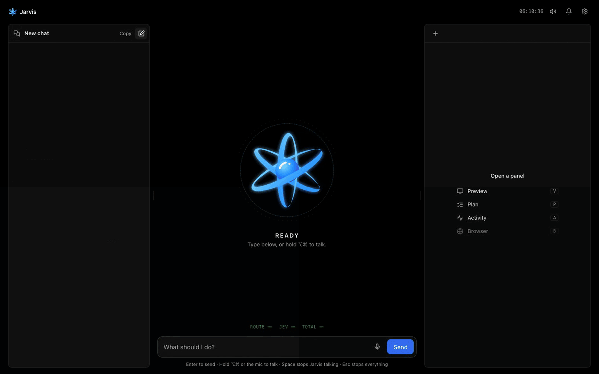
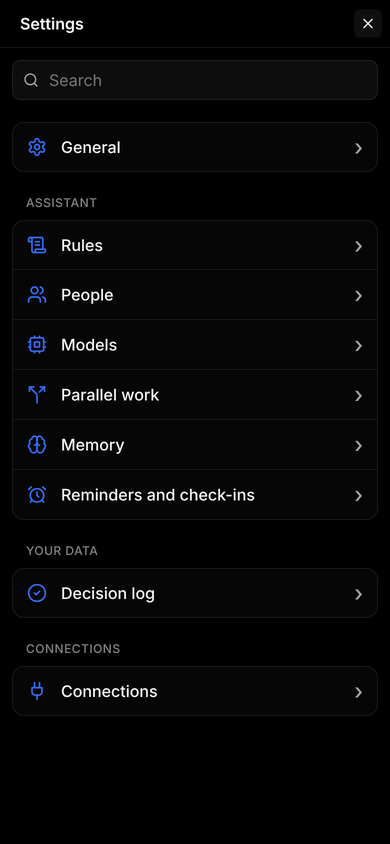

# Jarvis Open

Jarvis is a single-user, voice-first assistant for macOS. It can look up information, queue background tasks, and present editable drafts for review. This is a release candidate, not a hosted or multi-user service.



## See it work

**It asks, you edit, it sends exactly that.** Every draft shows up as a card with who it's to, the channel and the exact words. Change them and the button becomes **Send my edit**.



**Ask several things at once.** Each request gets its own card and runs side by side; sends wait for your OK. (Recorded in mock mode, so the names and replies are fixtures.)



**Simple things are instant.** Volume, dark mode and opening or quitting apps skip the LLM.



**It can reach a spare iPhone too.** With the optional phone integration, Jarvis reads a spare iPhone over USB for apps with no Mac version.


Settings work on a phone-sized screen as well:



Private details in tool steps are blurred in these recordings.

## What is implemented

- A local FastAPI server and web UI, with an optional native macOS notch UI.
- Independently scheduled tasks, per-app locks, and parallel helpers.
- Optional local speech recognition (Whisper), speech synthesis (Kokoro), and model inference (Ollama); configurable cloud providers and optional cloud tools.
- Connectors for locally available apps and authorized accounts. Optional Dia extension and a spare-iPhone bridge are separate integrations.
- Editable drafts and a local decision log that can export draft/final records. There is no adapter training or continuous model update loop in this snapshot.

## Setup

Requires macOS, Python 3.12 and the frameworks/tools used by the integrations you choose. Review the permissions each connector needs before enabling it. Start with mock mode, which uses fixture responses instead of acting on your computer.

```sh
uv venv --python 3.12 .venv
uv pip install --python .venv/bin/python --no-deps -r requirements.lock
.venv/bin/python copilot_web.py --mock --no-browser
```

Open http://127.0.0.1:8765. To try real tools, review `docs/CONFIGURATION.md` and configure only the services you intend to use.

## Safety and privacy

Local inference is an option, not an offline-mode guarantee. Configured TypeSafe routing, GPT fallback, optional TinyFish actions, and other network integrations can send data off-device. Leave integrations disabled if you do not need them. API actions have approval checks; controls vary by integration and aren't a blanket guarantee for arbitrary UI clicks. Review drafts, logs, and exports before sharing them. Exported rows can still contain personal information such as names or message content.

## License

A public license is not yet selected. Do not assume permission to redistribute this release candidate until an approved license is included.
